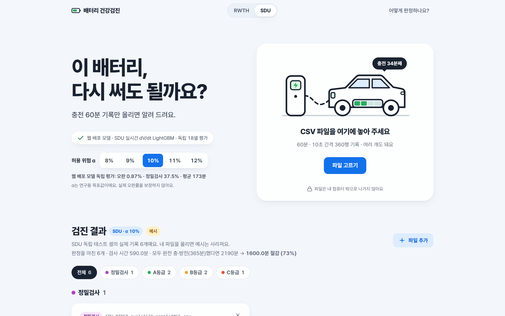
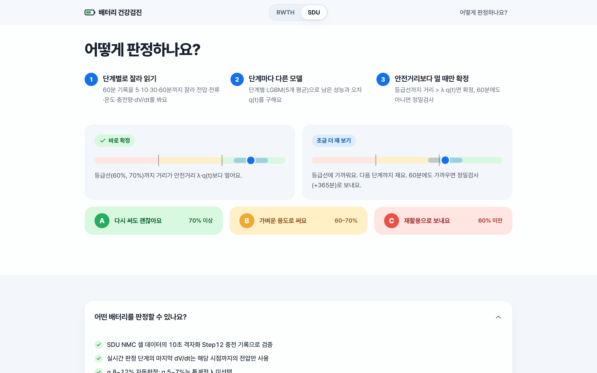
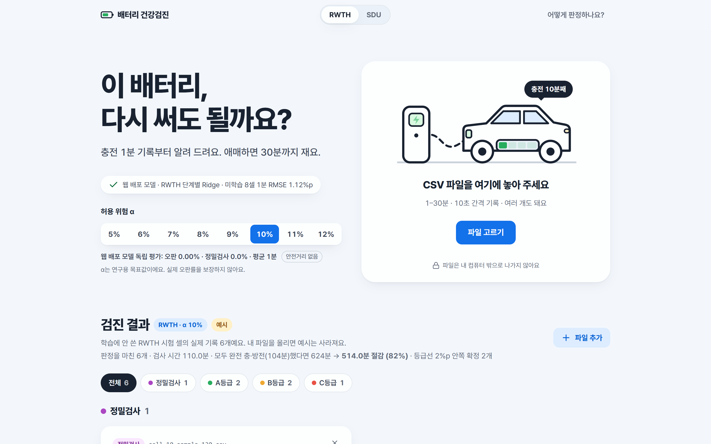
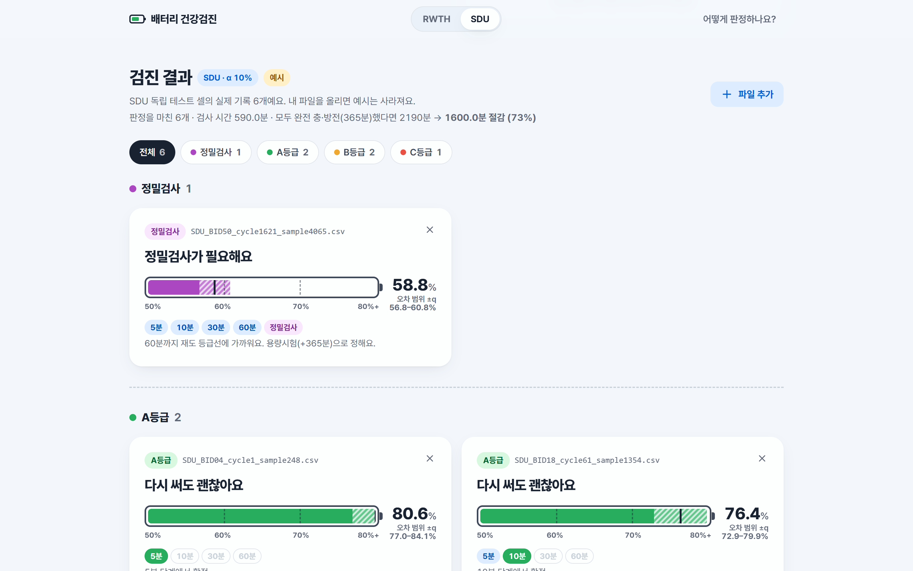
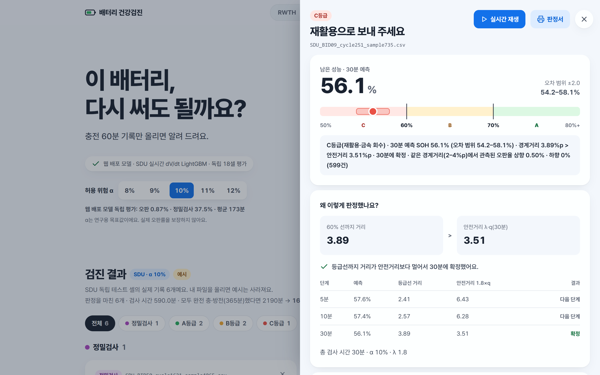
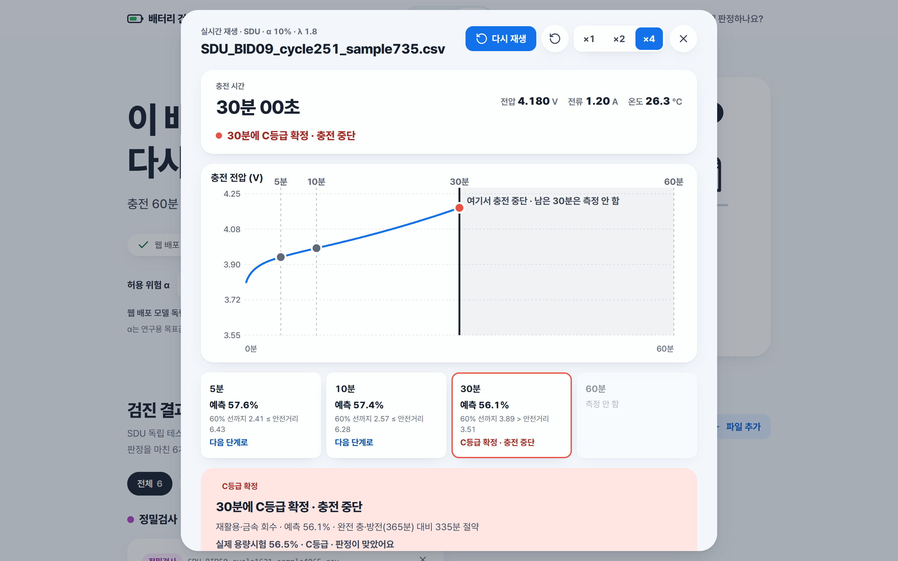
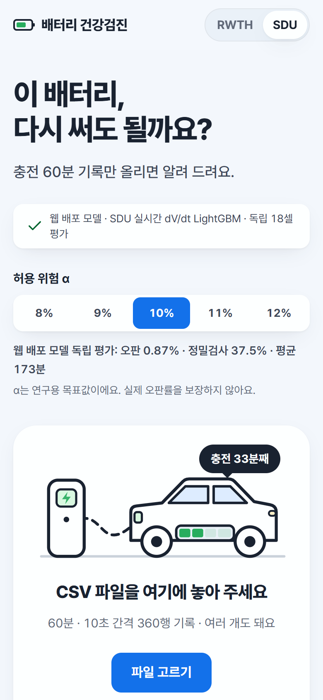

<div align="center">

# 배터리 건강검진

### 이 배터리, 다시 써도 될까요?

충전 기록 몇 분만 보고 사용 후 배터리의 남은 성능(SOH)을 예측하고,<br>
**확실할 때만 그 자리에서 등급을 확정**하는 단계별 판정 웹앱

<br>

[](https://munwalk.github.io/soh-early-checkup/)


<br>



</div>

<br>

## 한눈에 보기

> 사용 후 배터리를 재사용할지 정하려면 보통 완전 충·방전 용량시험을 해야 해서 **배터리 하나에 몇 시간**이 걸려요.<br>
> 이 앱은 충전 초반 기록만으로 SOH를 예측하고, 예측이 등급선에서 충분히 멀 때만 확정해 **검사 시간을 크게 줄여요**.<br>
> 애매한 배터리는 억지로 판정하지 않고 더 재거나 정밀검사로 보내요.

<table>
  <tr>
    <td align="center" width="25%"><h3>단계별 판정</h3>1·2·5·10·30분<br>(SDU 5·10·30·60분)마다<br>다시 판단</td>
    <td align="center" width="25%"><h3>안전거리 λ·q(t)</h3>단계별 예측 오차로<br>확정 여부를 정하는<br>통계적 기준</td>
    <td align="center" width="25%"><h3>브라우저 전용</h3>모델이 JS로 이식돼<br>파일이 내 컴퓨터<br>밖으로 안 나가요</td>
    <td align="center" width="25%"><h3>실시간 재생</h3>기록을 실시간처럼<br>흘려 넣어 판정 과정을<br>눈으로 확인</td>
  </tr>
</table>

<br>

## 어떻게 판정하나요?

```mermaid
flowchart LR
    A([충전 시작]) --> B[단계 t까지의<br/>기록만 잘라 읽기]
    B --> C[단계별 모델로<br/>SOH 예측 ŷ, 오차 q&#40;t&#41;]
    C --> D{등급선까지 거리<br/>d = min&#40;|ŷ−60|, |ŷ−70|&#41;<br/>&gt; λ·q&#40;t&#41; ?}
    D -- 예 --> E([등급 확정<br/>충전 중단])
    D -- 아니요 --> F{마지막 단계?}
    F -- 아니요 --> B
    F -- 예 --> G([정밀검사<br/>용량시험])
```

1. **단계별로 잘라 읽기** — 충전 기록을 단계 시점까지 잘라 전압·전류·온도·충전량 등에서 특징을 뽑아요. 각 단계는 그때까지 들어온 데이터만 써요.
2. **단계마다 다른 모델** — 단계별로 따로 학습한 모델이 SOH 예측값과 그 단계의 오차 크기 `q(t)`를 내놓아요.
3. **안전거리보다 멀 때만 확정** — 예측값이 등급선(60%, 70%)에서 `λ·q(t)`보다 멀면 확정하고 충전을 멈춰요. 가까우면 다음 단계까지 더 재고, 마지막 단계까지 애매하면 정밀검사로 보내요.

`λ`는 사용자가 고른 **허용 위험 α**에 맞춰 LTT(Learn-Then-Test) 방식으로 미리 정해 둔 값이에요. 예측 SOH가 평가 데이터 범위(48–83%) 밖이면 자동 확정하지 않고 정밀검사로 보내요.

<div align="center">

</div>

### 등급 기준

| 등급 | SOH | 의미 |
|:---:|:---:|---|
| 🟢 **A** | 70% 이상 | 다시 써도 괜찮아요 |
| 🟡 **B** | 60–70% | 가벼운 용도(ESS 등)로 써요 |
| 🔴 **C** | 60% 미만 | 재활용으로 보내요 |
| 🟣 **정밀검사** | – | 마지막 단계까지 등급선에 가까워 용량시험으로 정해요 |

<br>

## 두 가지 데이터셋, 두 가지 모델

상단의 **RWTH / SDU** 버튼으로 바꿀 수 있어요. 두 모델은 학습 데이터, 안전거리(q·λ)를 서로 공유하지 않아요.

| | **RWTH** | **SDU** |
|---|---|---|
| 대상 셀 | Sanyo UR18650E | SDU 노화 데이터셋 셀 |
| 판정 단계 | 1 · 2 · 5 · 10 · 30분 | 5 · 10 · 30 · 60분 |
| 모델 | 단계별 Ridge 회귀 | 단계별 LightGBM (5개 평균) |
| 입력 | 10초 간격, 1분(7행) 이상 | 10초 간격 Step12 충전 60분(360행) |
| 허용 위험 α | 5–12% | 8–12% |
| 정밀검사 가정 | +104분 | +365분 |

<div align="center">

</div>

<br>

## 화면 둘러보기

<table>
  <tr>
    <td width="50%"></td>
    <td width="50%"></td>
  </tr>
  <tr>
    <td align="center"><b>검진 결과</b><br><sub>등급별로 모아 보고, 확정 단계와 오차 범위, 절약한 검사 시간을 한눈에</sub></td>
    <td align="center"><b>자세히 보기</b><br><sub>단계별 예측·등급선 거리·안전거리 표와 같은 구간의 관측 오판율</sub></td>
  </tr>
  <tr>
    <td width="50%"></td>
    <td width="50%" align="center"></td>
  </tr>
  <tr>
    <td align="center"><b>실시간 재생</b><br><sub>전압 곡선이 그려지다 확정되는 순간 충전을 멈추고 남은 구간을 회색 처리</sub></td>
    <td align="center"><b>모바일</b><br><sub>390px 폭까지 가로 넘침 없이 대응</sub></td>
  </tr>
</table>

### 주요 기능

- **CSV 드래그 앤 드롭** — 여러 배터리 파일을 한 번에 올리면 각각 판정해요.
- **예시 데이터 내장** — 학습에 쓰지 않은 실제 셀 기록 6개가 처음부터 들어 있어요. 실제 용량시험 값과 맞았는지도 보여 줘요.
- **허용 위험 α 조절** — α를 바꾸면 안전거리와 판정 결과가 바로 다시 계산돼요.
- **관측 오판율** — 확정 시점의 경계거리 구간(1%p 이하 / 1–2 / 2–4 / 4–6 / 6%p 초과)에서 실제로 관측된 오판 비율을 보여 줘요.
- **판정서 인쇄** — 배터리별 판정 근거를 한 장으로 출력하거나 PDF로 저장해요.
- **실시간 재생** — 기록된 충전 데이터를 실시간처럼 흘려 넣어 단계마다 어떻게 판정되는지 보여 줘요. (×1 · ×2 · ×4)

<br>

## 바로 써 보기

### 온라인

👉 **https://munwalk.github.io/soh-early-checkup/**

### 로컬에서

빌드도 설치도 필요 없어요. 정적 파일만으로 돌아가요.

```bash
git clone https://github.com/munwalk/soh-early-checkup.git
cd soh-early-checkup
python -m http.server 8000
# http://localhost:8000 접속
```

`index.html`을 브라우저로 바로 열어도 돼요.

<details>
<summary><b>CSV 형식 (RWTH)</b></summary>

<br>

충전 시작(0초)부터 10초 간격, 한 파일에 배터리 하나.

| time_s | voltage_V | current_A | charge_Ah | energy_Wh | temperature_C |
|---:|---:|---:|---:|---:|---:|
| 0 | 3.525 | 0.023 | 0.0000 | 0.0000 | 28.19 |
| 10 | 3.768 | 4.100 | 0.0113 | 0.0423 | 28.25 |
| … | | | | | |
| 1800 | 3.898 | 0.290 | 0.7923 | 3.0811 | 28.12 |

- 1분(7행)부터 판정해요. 30분(181행)을 올리면 모든 단계를 한 번에 봐요.
- `charge_Ah`, `energy_Wh`는 누적값이에요. 첫 값이 0이 아니면 빼서 써요.

</details>

<details>
<summary><b>CSV 형식 (SDU)</b></summary>

<br>

Step12 충전 구간, 10초부터 3600초까지 10초 간격 360행.

| time_s | voltage_V | current_A | temperature_C | charge_Ah_from_10s | dvdt_mV_min |
|---:|---:|---:|---:|---:|---:|
| 10 | 3.6339 | 1.2003 | 25.99 | 0.0000 | 58.43 |
| 20 | 3.6436 | 1.2001 | 25.96 | 0.0033 | 49.41 |
| … | | | | | |
| 3600 | 4.0686 | 1.2000 | 25.73 | 1.1967 | 8.14 |

- `charge_Ah_from_10s` 대신 `charge_Ah`도 돼요.
- `dvdt_mV_min`이 없으면 전압에서 직접 계산해요. 각 단계의 마지막 dV/dt는 그 시점까지의 전압만 써요.

</details>

<br>

## 검증

| 항목 | 결과 |
|---|---|
| 모델 이식 정확도 | Python 원본 모델과 JS 이식본의 특징값·예측값 일치 (`tools/verify_*`) |
| SDU 독립 평가 (18셀 · 1,729건, α 10%) | 오판 **0.87%** · 정밀검사 37.5% · 평균 검사 시간 173분 |
| RWTH 미학습 8셀 | 1분 단계 RMSE **1.12%p** |
| 브라우저 E2E | 실제 Chrome에서 파일 업로드 후 화면 판정과 Node 계산값 비교, SDU 12/12 · RWTH 22/22 일치 |
| 실시간 재생 | 기존 판정과 5,477건 전부 일치 (확정 단계·등급·예측값·정밀검사) |

<br>

## 프로젝트 구조

```
soh-early-checkup/
├── index.html              # 화면 구조
├── style.css               # 스타일 (Pretendard)
├── app.js                  # 업로드 · 결과 · 자세히 보기 · 판정서
├── replay.js               # 실시간 재생 모드
├── rwth_engine.js          # RWTH 특징 추출 + 단계별 판정
├── rwth_model.js           # RWTH Ridge 계수 · q(t) · α별 λ
├── rwth_demo*.js           # RWTH 예시 데이터
├── sdu_engine.js           # SDU 특징 추출 + 단계별 판정
├── sdu_model.js            # SDU LightGBM 트리 (처음 SDU를 고를 때 불러옴)
├── misgrade_data.js        # 경계거리 구간별 관측 오판율
├── data/                   # 오판율 원본 JSON
├── tools/                  # 모델 변환 · 검증 스크립트 (Node / Python)
└── docs/screenshots/       # README 이미지
```

<br>

## 알아 두세요

- **α는 연구용 목표값**이에요. 실제 오판율을 보장하지 않아요.
- 실시간 재생은 **기록된 데이터를 재생**하는 화면이에요. 충전 장비와 실시간으로 연동되지는 않아요.
- 학습 조건과 다른 셀·충전 프로토콜의 기록이면 결과를 믿지 마세요. 실제 현장 검증은 하지 않았어요.
- 10초 격자가 아닌 원시 기록은 아직 받지 않아요.

<br>

## 데이터 출처

- **RWTH** — RWTH Aachen 대학의 Sanyo UR18650E 셀 노화 시험 데이터
- **SDU** — SDU 공개 배터리 노화 데이터셋

<br>

<div align="center">

**졸업루키즈** · 배터리 재사용 등급 판정 졸업작품

<sub>Made with HTML · CSS · Vanilla JS — no framework, no server</sub>

</div>
